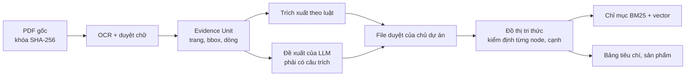
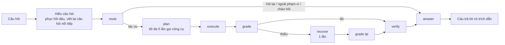

<div align="center">

# OCOP GraphRAG

**Agent hỏi đáp văn bản OCOP, mọi câu trả lời đều truy ngược được về PDF gốc**

[](https://github.com/nvtanphat/ocop-rag/actions/workflows/ci.yml)
[](LICENSE)


</div>

OCOP GraphRAG là trợ lý tra cứu văn bản về Chương trình mỗi xã một sản phẩm (OCOP). Mỗi câu trả lời được ghép từ các claim ngắn. Mỗi claim trỏ về PDF gốc qua văn bản, trang, vùng bằng chứng và mã SHA-256 của file. Claim không kiểm chứng được với nguồn sẽ bị loại trước khi đến người dùng.

## Mục lục

- [Tính năng](#tính-năng)
- [Nguồn dữ liệu](#nguồn-dữ-liệu)
- [Kiến trúc](#kiến-trúc)
- [Bắt đầu nhanh](#bắt-đầu-nhanh)
- [Sử dụng](#sử-dụng)
- [Cấu hình](#cấu-hình)
- [Đánh giá](#đánh-giá)
- [Cấu trúc thư mục](#cấu-trúc-thư-mục)
- [Phát triển](#phát-triển)
- [Nguyên tắc thiết kế](#nguyên-tắc-thiết-kế)
- [Giới hạn](#giới-hạn)
- [Tài liệu](#tài-liệu)
- [Đóng góp](#đóng-góp)
- [Giấy phép](#giấy-phép)
- [Trích dẫn](#trích-dẫn)

## Tính năng

- **Hỏi đáp có trích dẫn.** Hỏi bằng tiếng Việt có dấu hoặc không dấu, hỏi tiếp nhiều lượt ("còn tiện nghi thì sao"). Phần tài liệu không trả lời được ghi rõ là "Chưa tìm thấy trong tài liệu", không đoán.
- **Xem bằng chứng trên PDF.** Mở đúng trang gốc, tô đúng vùng được trích và tự cuộn tới vùng đó.
- **Đồ thị dẫn chứng.** Từ một trích dẫn, thấy tiêu chí nằm ở phiếu chấm, phần và nhóm nào, kèm các mức điểm.
- **Bảng tiêu chí chấm điểm.** Tiêu chí của 52 phiếu chấm (QĐ 26/2026 và QĐ 148/2023), lọc theo văn bản và bộ sản phẩm, có điểm tối đa và căn cứ trang, xuất CSV.
- **Danh mục sản phẩm đã công nhận.** Sản phẩm trong các quyết định công nhận của Hải Phòng và Huế.
- **Tra cứu có cấu trúc qua đồ thị.** Khung điểm từng hạng sao, điểm tối đa của từng tiêu chí, sản phẩm theo địa phương và hạng sao, văn bản thay thế văn bản nào.

## Nguồn dữ liệu

12 văn bản, 583 trang PDF trong `data/raw/ocop`, khóa bằng SHA-256 tại `configs/ocop_sources.lock.json`.

| Nhóm | Văn bản |
| --- | --- |
| Khung OCOP hiện hành | 26/2026/QĐ-TTg |
| Khung OCOP đã được thay thế | 148/QĐ-TTg (2023); 1489/QĐ-TTg (2025, sửa đổi 148) |
| Quyết định công nhận | 525/QĐ-UBND Hải Phòng; 797/QĐ-UBND Huế |
| Hướng dẫn địa phương | Phường Thành Sen, Hà Tĩnh |
| Văn bản ngành | Luật An toàn thực phẩm 55/2010/QH12; Nghị định 15/2018/NĐ-CP; Nghị quyết 15/2026/NQ-CP; Nghị định nhãn hàng hóa 43/2017/NĐ-CP và 111/2021/NĐ-CP; Luật Hợp tác xã 17/2023/QH15 |

Khi câu hỏi không nêu năm hay số văn bản, hệ thống ưu tiên văn bản đang có hiệu lực. Đoạn trích của văn bản đã được thay thế được gắn nhãn, và chỉ dùng cho phần văn bản hiện hành không trả lời được.

## Kiến trúc

**Dựng corpus** chạy một lần, khi nguồn hoặc mã trích xuất thay đổi:



**Trả lời một câu hỏi** do agent xử lý theo đồ thị trạng thái (LangGraph):



Các bước chính:

1. **Hiểu câu hỏi.** Phục hồi dấu, viết lại câu hỏi nối tiếp thành câu độc lập, tách câu hỏi ghép, liên kết thực thể (văn bản, địa phương, sản phẩm, phiếu chấm).
2. **route.** Chọn ý định qua ba tầng: luật tất định, so khớp câu mẫu bằng embedding, và model khi cần.
3. **plan và execute.** Chỉ gọi công cụ trong danh sách đăng ký, tối đa 5 lần. Có 11 công cụ: tìm kiếm văn bản lai, tra điều khoản, biểu mẫu, tiêu chí, nhóm sản phẩm, hồ sơ minh chứng, quyết định công nhận, khung hạng sao, duyệt đồ thị, kiểm tra hiệu lực theo thời gian, mở vùng nguồn.
4. **Truy xuất.** BM25 kết hợp vector EmbeddingGemma (Qdrant) bằng RRF, rồi rerank bằng cross-encoder `bge-reranker-v2-m3` (ONNX int8 trên CPU).
5. **answer.** LLM soạn claim, mỗi claim kèm câu trích nguyên văn. Từng claim được kiểm chứng: câu trích có trong nguồn, mã trích dẫn khớp, điểm và hạng sao gắn đúng bản ghi. Các số suy ra (khung sao, đếm sản phẩm, điểm và tiêu chí con) được đối chiếu với đồ thị.

Chi tiết: [docs/ARCHITECTURE.md](docs/ARCHITECTURE.md).

## Bắt đầu nhanh

### Yêu cầu

- Python 3.11+
- Node.js 22.14+
- Git LFS (đồ thị lưu bằng LFS)
- Docker: chỉ cần khi chạy truy xuất hybrid (Qdrant) hoặc Neo4j
- Một LLM có API tương thích OpenAI

### Cài đặt

```powershell
git lfs install
git clone https://github.com/nvtanphat/ocop-rag.git
cd ocop-rag
python -m pip install -e ./ocop_contracts -e ./ocr -e ".[agent,persistence,dev]"
copy .env.example .env    # điền endpoint, khóa và tên model của LLM
```

### Chạy

```powershell
.\run.ps1
```

Mở http://127.0.0.1:8000. Script build giao diện rồi chạy API phục vụ cả hai; thêm `-BackendOnly` khi đã có `frontend/dist`.

Repo đã có sẵn corpus đã dựng (pages, knowledge, graph, index), nên không cần chạy OCR hay trích xuất để dùng thử. Mặc định hệ thống tìm kiếm bằng BM25.

### Bật truy xuất hybrid

Đây là cấu hình dùng để đo các kết quả ở mục [Đánh giá](#đánh-giá):

```powershell
python -m pip install -e ".[retrieval]"
docker compose --profile stores up -d qdrant
$env:OCOP_RETRIEVAL_PROFILE = "hybrid"
$env:OCOP_RERANK = "1"
python tools/cli.py run --build-only --dense
.\run.ps1 -BackendOnly
```

> [!WARNING]
> Khi bật hybrid mà Qdrant không chạy, hệ thống tự lùi về BM25 mà không báo lỗi. Kiểm tra `GET /api/ocop/health`: `retrieval_profile.ready` phải là `true`.

Chạy bằng Docker và xử lý sự cố: [docs/RUNBOOK.md](docs/RUNBOOK.md).

## Sử dụng

### Giao diện web

| Khu vực | Chức năng |
| --- | --- |
| Hỏi đáp | Hỏi nhiều lượt; mỗi ý có trích dẫn bấm được |
| Trình xem PDF | Trang gốc với vùng bằng chứng được tô |
| Đồ thị dẫn chứng | Tiêu chí trong phiếu chấm, phần, nhóm và các mức điểm |
| Tài liệu | 12 văn bản nguồn |
| Tiêu chí / Sản phẩm | Bảng tra cứu đã kiểm định, lọc và xuất CSV |

### API

```bash
curl -X POST http://127.0.0.1:8000/api/ocop/query \
  -H "Content-Type: application/json" \
  -d '{"query": "sản phẩm 5 sao do cấp nào công nhận", "session_id": "demo", "retrieval_mode": "hybrid", "use_llm": true}'
```

Phản hồi gồm `answer`, `status` và `citations`. Mỗi trích dẫn có `source_id`, `pdf_page`, `bbox`, `evidence_unit_id` và `source_sha256`.

| Endpoint | Nội dung |
| --- | --- |
| `POST /api/ocop/query` | Hỏi đáp |
| `GET /api/ocop/health` | Trạng thái corpus, profile truy xuất, LLM |
| `GET /api/ocop/sources` | Danh sách văn bản |
| `GET /api/ocop/criteria`, `/products` | Bảng tiêu chí và sản phẩm đã kiểm định |
| `GET /api/ocop/graph/subgraph` | Lân cận đồ thị của node hoặc đoạn bằng chứng |
| `GET /api/ocop/sources/{id}/pdf` | PDF gốc |
| `GET /api/ocop/sources/{id}/pages/{page}/evidence.png` | Trang PDF có vùng bằng chứng được tô |

### Dòng lệnh

| Lệnh | Việc |
| --- | --- |
| `python tools/cli.py run --build-only` | Dựng hoặc cập nhật corpus từ dataset OCR |
| `python tools/cli.py run --query "..."` | Trả lời một câu hỏi |
| `python tools/cli.py status` | Kiểm tra corpus nhất quán và sẵn sàng |
| `python tools/cli.py graph refresh-index` | Làm mới chỉ mục sau khi đồ thị đổi; tự xuất lại bảng tiêu chí và sản phẩm |
| `python tools/cli.py graph export-extraction` | Xuất file trích xuất để người duyệt sửa |
| `python tools/cli.py graph publish-neo4j` | Đẩy đồ thị đã kiểm định lên Neo4j |

## Cấu hình

| File | Nội dung |
| --- | --- |
| `.env` | LLM trả lời (`OCOP_ANSWER_LLM_*`), LLM trích xuất (`OCOP_EXTRACT_LLM_*`), `OCOP_RETRIEVAL_PROFILE`, `OCOP_RERANK` |
| `configs/ocop_models.yaml` | Model nhúng, reranker, cửa sổ ngữ cảnh LLM |
| `configs/ocop_retrieval.yaml` | Ngân sách truy xuất và prompt: số khối nguồn, token, RRF, rerank |
| `configs/ocop_language.yaml` | Toàn bộ từ vựng tiếng Việt mà router và bộ kiểm chứng dùng |
| `configs/ocop_sources.json` | Danh sách văn bản và loại văn bản |

Chi tiết: [docs/CONFIGURATION.md](docs/CONFIGURATION.md).

## Đánh giá

Kết quả hiện tại, chấm theo trang trên corpus đang phục vụ (hybrid + rerank):

| Bộ đo | Kết quả |
| --- | --- |
| Truy xuất, 100 câu | Top-1 75 · MRR 0,848 · Recall@5 0,99 · Recall@10 1,0 |
| Router, 80 câu | Ý định 65/80 · phạm vi 77/80 · slot 31/32 |

```powershell
python tools/evaluate_gold.py run retrieval --llm stub --out ../runs/retrieval.jsonl
python tools/evaluate_gold.py score retrieval ../runs/retrieval.jsonl
python tools/evaluate_router.py --sealed
```

Các bộ citation, multihop, hội thoại và từ chối trả lời cần LLM thật (`--llm real`). Cách đo và đọc kết quả: [docs/EVALUATION.md](docs/EVALUATION.md).

## Cấu trúc thư mục

```
ai_core/
  processing/      Evidence Unit, ứng viên trích xuất
  knowledge/       trích xuất phiếu chấm, tiêu chí, thủ tục, đề xuất LLM
  graph/           dựng đồ thị, kiểm định nguồn, tra cứu
  retrieval/       chia chunk, BM25, vector, rerank
  orchestration/   agent: router, planner, công cụ, kiểm chứng claim
  evaluation/      bộ chấm, giả lập lỗi, cổng phát hành
  system/          pipeline dựng corpus, làm mới chỉ mục
backend/api/       FastAPI
frontend/          React + Vite
ocop_contracts/    model dữ liệu dùng chung
ocr/               dự án OCR độc lập
configs/           cấu hình model, truy xuất, từ vựng, nguồn
data/raw/ocop/     PDF gốc, không bao giờ sửa
data/processed/    corpus đã dựng
data/evaluations/  bộ câu hỏi gold
tools/             CLI và công cụ đánh giá
tests/             test backend và fixture
docs/              kiến trúc, vận hành, cấu hình, đánh giá, ADR
```

## Phát triển

```powershell
python -m pytest -q                 # backend và OCR, không gọi mạng hay model thật
ruff check .
Push-Location frontend; npm ci; npm test; npm run build; Pop-Location
```

Bộ test gồm một test đọc thẳng đồ thị đang phục vụ: mỗi phiếu chấm của văn bản hiện hành phải đủ Phần A, B, C và tổng 100 điểm. Dựng lại đồ thị mà làm hỏng cấu trúc phiếu thì test báo đỏ ngay.

Hướng dẫn chi tiết: [docs/DEVELOPMENT.md](docs/DEVELOPMENT.md).

## Nguyên tắc thiết kế

- **Nguồn bất biến.** PDF trong `data/raw/ocop` không bao giờ bị sửa. Mọi trích dẫn giữ trang, bbox, mã bằng chứng và SHA-256, không bao giờ tạo giả.
- **Kiểm chứng trước khi hiển thị.** Ứng viên OCR chưa kiểm chứng tách khỏi dữ kiện đã kiểm chứng; điểm và hạng sao chưa kiểm chứng không được dùng để kết luận.
- **Công cụ có kiểm soát.** Agent chỉ gọi công cụ đã đăng ký; công cụ riêng tư cần xác thực.
- **Dữ liệu công khai.** Chỉ mục công khai không chứa dữ liệu riêng của đơn vị hay hồ sơ; định danh trong bộ nhớ phiên được che.
- **Không suy đoán hiệu lực.** Hệ thống không tự kết luận văn bản nào áp dụng cho một năm hay ngày cụ thể khi chưa có quy tắc hiệu lực đã kiểm định.

Quy tắc sửa mã: [AGENTS.md](AGENTS.md). Quyết định thiết kế: [docs/adr](docs/adr/README.md).

## Giới hạn

- Hệ thống chỉ trả lời từ 12 văn bản trong corpus. Sản phẩm không được nêu đích danh (ví dụ "bánh tráng") không phân loại được chắc chắn, và câu trả lời sẽ nói rõ điều đó.
- Một số ô điểm trong phiếu QĐ 148 bị OCR đọc thiếu hoặc sai số. Dữ liệu đã chốt nên giữ nguyên, và các điểm đó không qua kiểm định.
- Câu trả lời của LLM có thể khác nhau giữa các lần hỏi. Lớp kiểm chứng chặn claim không có căn cứ, nhưng không làm câu trả lời giống hệt nhau.

## Tài liệu

| Tài liệu | Nội dung |
| --- | --- |
| [ARCHITECTURE](docs/ARCHITECTURE.md) | Luồng hỏi đáp, API, frontend |
| [RUNBOOK](docs/RUNBOOK.md) | Khởi động, Docker, xử lý sự cố |
| [CONFIGURATION](docs/CONFIGURATION.md) | Profile truy xuất, model, biến môi trường |
| [EVALUATION](docs/EVALUATION.md) | Bộ đo, cách chạy, cách đọc kết quả |
| [DEVELOPMENT](docs/DEVELOPMENT.md) | Cài đặt, kiểm thử, frontend |
| [GLOSSARY](GLOSSARY.md) | Thuật ngữ |
| [ADR](docs/adr/README.md) | Quyết định thiết kế |
| [OCR](ocr/README.md) | Quy trình OCR độc lập |

### Dữ liệu trong Git

Repo lưu dataset OCR đã xử lý, file trích xuất có thể sửa, pages, knowledge, index và snapshot đồ thị đang hoạt động. File đồ thị lớn lưu bằng Git LFS. Nếu đã clone mà chưa có LFS, chạy `git lfs install` rồi `git lfs pull`. Cache, log, snapshot cũ và trọng số model OCR không đưa vào Git. Khi dựng lại đồ thị, thêm snapshot mới bằng `git add -f data/processed/ocop/graph/snapshots/<graph_version>`. Dữ liệu trong Qdrant và Neo4j nằm ngoài repo; dựng lại theo [RUNBOOK](docs/RUNBOOK.md).

## Đóng góp

1. Đọc [AGENTS.md](AGENTS.md) và [docs/DEVELOPMENT.md](docs/DEVELOPMENT.md).
2. Tạo nhánh từ `dev`.
3. Giữ nguyên các test về nguồn gốc trích dẫn, điểm và hạng sao, quyền riêng tư; không nới điều kiện để test qua.
4. Chạy `python -m pytest -q`, `ruff check .` và test frontend trước khi mở pull request.
5. Thay đổi mã trích xuất, đồ thị hoặc chỉ mục thì dựng lại dữ liệu và đo lại bộ truy xuất.

Báo lỗi và đề xuất qua [GitHub Issues](https://github.com/nvtanphat/ocop-rag/issues).

## Giấy phép

Mã nguồn phát hành theo giấy phép [MIT](LICENSE). Các văn bản pháp luật trong `data/raw/ocop` là văn bản công khai của cơ quan nhà nước, được đưa vào để tra cứu.

## Trích dẫn

Nếu dùng dự án trong nghiên cứu, vui lòng trích dẫn:

```bibtex
@software{ocop_graphrag_2026,
  author = {nvtanphat},
  title  = {OCOP GraphRAG: Agent hỏi đáp văn bản OCOP có trích dẫn truy ngược về nguồn},
  year   = {2026},
  url    = {https://github.com/nvtanphat/ocop-rag},
  license = {MIT}
}
```
