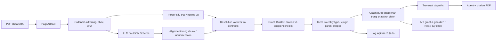

# Audit và triển khai Extraction → Knowledge Graph → Retrieval → Agent

Ngày: 20/10/2026. Baseline: commit `223f405`; thay đổi của lượt này chưa commit.

## Kết quả và trạng thái bàn giao

Đã triển khai cổng kiểm tra tự động và nối trực tiếp vào builder, snapshot, traversal, Agent, API graph và giao diện hiện có. Graph dùng cho truy vấn là tập thực thể/quan hệ đã qua kiểm tra nguồn, loại và vị ngữ; không cần có ledger human review để hoạt động. Không cài framework mới, không thay PDF/registry/lock, không tạo pipeline extraction độc lập.

Phạm vi kiểm chứng theo yêu cầu là chạy mẫu. Đã dừng OCR toàn corpus và supervisor tự chạy lại. Snapshot hồi quy 39 trang bên dưới là kiểm tra nguồn thật, có `source_complete=False`; không đổi thành ready hay công bố là graph đầy đủ của corpus. Các số node/edge kiểm thử không phải Precision/Recall/F1.

## Kiến trúc đã kiểm tra

| Thành phần | Code chính | Đánh giá baseline và hướng xử lý |
|---|---|---|
| Nguồn và OCR | `processing/ocop/pdf_loader.py`, `registry.py`, `pdf_pipeline.py`, `artifact_cache.py`, `easy_viet_ocr.py`, `domain/ocop_models.py` | Có source lock, SHA, PageArtifact, cache và provenance trang/ô. Giữ nguyên đường OCR; ký tự OCR vẫn có thể sai và không được biến thành điểm/sao xác nhận. |
| Evidence và extraction | `processing/ocop/knowledge_extract.py`, `business_candidates.py`, `knowledge/ocop/extractor.py` | Một bộ điều phối cho EvidenceUnit, deterministic extraction và LLM opt-in. Giữ lại, bổ sung kiểm tra hợp đồng và thống kê các unit chưa gửi LLM vì giới hạn ngân sách. |
| Parser nghiệp vụ | `legal_structure.py`, `article_tree.py`, `criterion_sheets.py`, `procedures.py`, `star_requirements.py`, `authorities.py`, `table_continuity.py` | Đã có cấu trúc Điều/Khoản/Điểm, phiếu/tiêu chí/phương án, cơ quan/thủ tục, registry văn bản và dấu sao. Deterministic origin không tự chứng minh mọi quan hệ đúng; bổ sung kiểm tra độc lập khi tạo graph phục vụ truy vấn. |
| Entity/attribute/relation | `knowledge/ocop/contracts.py`, `llm_proposals.py`, `orchestration/ocop/llm.py` | Whitelist và JSON mode đã có nhưng thiếu schema tại provider, chứng cứ riêng của thuộc tính và kiểm tra phạm vi chunk. Đã bổ sung JSON Schema, AttributeClaim, kiểm tra chunk và xử lý phản hồi lỗi/cắt token. |
| Resolution | `llm_proposals.py: reconcile`, `extractor.py`, `authorities.py`, `legal_structure.py` | Có linking theo tên/vị trí, alias cơ quan và số văn bản. Ghép tên đơn thuần có thể nhập nhầm chủ thể; đã siết phạm vi, giữ xung đột và chuẩn hóa lại cạnh sau linking. Không coi tên giống nhau ở hai văn bản là cùng pháp nhân. |
| Ontology và quality | `contracts.py`, `graph/ocop/ontology.py`, `knowledge/ocop/shapes.py`, `quality.py` | Có endpoint types, kiểm tra số học và shape audit. Graph nay kế thừa các business types/triples từ contracts; cổng sử dụng shape cha/con để loại orphan và parentage mâu thuẫn. |
| Builder và lưu trữ | `graph/ocop/builder.py`, `grounding.py`, `integrity.py`, `review.py`, `store.py` | Baseline kiểm citation tốt, có snapshot bất biến, nhưng citation hợp lệ vẫn cho phép cạnh sai nghĩa. Đã thêm tập được chấp nhận, lý do loại trừ, hash cho toàn bộ snapshot và chế độ xuất Neo4j đúng tập này. |
| Retrieval và Agent | `retrieval/ocop/index_pipeline.py`, `structure_chunker.py`, `lookup.py`, `search.py`; `orchestration/ocop/tools.py`, `planner.py`, `workflow.py`, `answer.py`, `verification.py`, `evidence_grader.py` | Có BM25/dense, DAG tool tối đa 5 call, version checks và chặn điểm/sao chưa verified. Baseline đòi verified cho graph seeds nên machine graph ít được dùng; đã cho phép source locations làm seed và chỉ duyệt graph đã qua cổng ngữ nghĩa. Các slot/rule nghiệp vụ nhạy cảm vẫn cần nguồn verified. |
| API và frontend | `backend/api/ocop_routes.py`, `frontend/src/ocop/KnowledgeViews.tsx`, `api.ts`, `pages/Dashboard.tsx` | Public graph trước đây đọc toàn bộ candidates. Nay đọc cùng tập được chấp nhận với Agent; mở PDF tại trang citation, hiển thị số liệu của tập này và phân biệt kiểm tra nguồn với xác nhận pháp lý. |

`GLOSSARY.md` và `docs/adr/` chưa có trong checkout này; không giả định có quyết định kiến trúc được ghi ở đó.

## Tham khảo và quyết định thiết kế

- Microsoft GraphRAG giữ liên kết entity/relation với text units và hỗ trợ graph tự cung cấp. Áp dụng provenance và hợp nhất có kiểm soát, không cần thay builder hay thêm community reports cho nghiệp vụ chưa có yêu cầu. [Custom Graphs](https://microsoft.github.io/graphrag/index/byog/).
- LightRAG phối hợp truy xuất graph và chunks. Áp dụng đường BM25 → EvidenceUnit → graph → chứng cứ; tần suất/weight không được dùng như độ đúng pháp lý. [Repository chính thức](https://github.com/HKUDS/LightRAG).
- LangExtract hỗ trợ extraction có cấu trúc và grounding vào văn bản nguồn. Áp dụng alignment trong đúng chunk cùng quote/page/bbox/SHA; alignment không phải semantic entailment. [Repository chính thức](https://github.com/google/langextract).
- LlamaIndex có SchemaLLMPathExtractor và property graph retrieval. Áp dụng schema/endpoint whitelist và đường truy vấn giới hạn, tiếp tục kiểm tra vị ngữ bên ngoài LLM. [Property Graph Index](https://developers.llamaindex.ai/python/framework/module_guides/indexing/lpg_index_guide/).

Chi tiết nguồn tham khảo: [OCOP_EXTRACTION_REFERENCE_RESEARCH.md](OCOP_EXTRACTION_REFERENCE_RESEARCH.md). Không thêm dependency của bốn framework.

## Luồng sau thay đổi



Đây là một lần extraction/build trong pipeline hiện có. Tập sử dụng và dữ liệu audit có chung node IDs, edge IDs, knowledge version và graph version. Không có một extractor hay một pipeline graph thứ hai.

## Hợp đồng dữ liệu và mức xác nhận

Trong cùng snapshot của builder:

| Artifact | Vai trò |
|---|---|
| `nodes.jsonl`, `edges.jsonl` | Dữ liệu extraction/audit và projection quyết định duyệt tương thích đường cũ; không còn là nguồn mặc định của Agent/public graph. |
| `agent_nodes.jsonl`, `agent_edges.jsonl` | Graph được chấp nhận và được Agent/API sử dụng trực tiếp. Có `validation.status=source_grounded`, phương pháp kiểm tra và `legal_verified=False`. |
| `excluded_assertions.jsonl` | ID, loại record và nguyên nhân không được sử dụng, gồm lỗi vai trò, vị ngữ, thuộc tính, parentage và endpoint. |
| `rejected.jsonl` | Lỗi hợp đồng ở builder, như citation hoặc nguồn sai. Không trộn số này với số loại trừ ngữ nghĩa. |
| `manifest.json` | Hash cả sáu JSONL, revision của policy, số lượng tập được chấp nhận và tổng hợp lý do loại trừ. |

`source_grounded` là kiểm tra tự động một quan sát hoặc một vị ngữ được hỗ trợ trong tài liệu. Nó không xác nhận chữ ký văn bản, hiệu lực hiện tại, điểm, xếp hạng sao hoặc tính đầy đủ của hồ sơ. `review_status` được giữ để tương thích và không tự nâng thành `verified`.

AttributeClaim giữ tên thuộc tính, giá trị, phương pháp trích xuất và evidence riêng chứa cả entity lẫn giá trị. Các cách đọc mâu thuẫn vẫn có thể kiểm tra lại. Khi association đạt cổng, tập sử dụng xuất tên chuẩn như `properties.packaging` và claim `status=source_grounded`; bản extraction gốc vẫn là `packaging_candidate`. Thay proof làm thay hash duyệt.

ID giữ ổn định cho cùng source/phạm vi/cấu hình. Product/Organization do LLM nêu được giới hạn trong EvidenceUnit; linking không dùng mỗi tên hoặc cùng trang. Organization từ bảng công nhận có thêm địa chỉ hoặc ô gốc trong khóa định danh. Tham chiếu liên văn bản cần số đăng ký phân giải rõ; không có global fuzzy merge pháp nhân.

## Những lỗi đã xử lý

| Lỗi tái hiện / hạn chế | Thay đổi |
|---|---|
| LLM có thể dùng tên nằm ngoài chunk đã đọc | Grounder giới hạn theo start/end của chunk, ánh xạ về offset/trang trong unit gốc. |
| Collection JSON sai kiểu bị coi là thành công hoặc làm crash | Kiểm tra collection trước merge/gleaning; lỗi có evidence unit ID và không tạo fact. Relation type sai kiểu cũng bị loại. |
| Chỉ kiểm literal giá trị thuộc tính, mất bằng chứng gán cho entity | AttributeClaim riêng, kiểm tra context, subject cạnh tranh, phủ định và xung đột. Verifier hiện chỉ nhận một số feature frames rõ ràng. |
| Xung đột issuer mất hai cách đọc; entity verified thừa hưởng feature LLM | Giữ các claims; thêm conflict flag; enrichment thay nội dung phải trở lại candidate. Cạnh phụ thuộc không giữ verified khi endpoint đã hạ trạng thái. |
| Reconcile đổi endpoint nhưng giữ ID cũ / lặp cạnh | Tạo lại ID từ endpoint chuẩn; dedupe cả các cạnh mới trong cùng lượt; tích lũy evidence. |
| Ghép hai sản phẩm/chủ thể chỉ vì trùng tên | Phạm vi unit, không dùng page-only/name-only fallback cho Product/Organization; không bỏ prefix đánh số của tên doanh nghiệp/sản phẩm. |
| Entity mượn citation của PDF khác | Chặn tại contracts và builder; ngoại lệ SourceDocument cần explicit registry resolution. Rule cũng phải khớp nguồn. |
| Hai tên cùng đoạn hoặc câu sản xuất bị coi là sở hữu | `OWNED_BY` chỉ dùng positive ownership frame; co-occurrence, phủ định và manufacturing-only không vào graph phục vụ Agent. |
| Citation đúng nhưng vai trò tài liệu/chủ thể không đúng | Kiểm tra role frame, header/cột/hàng/ô trong bảng công nhận và subject/action cho trách nhiệm. Không lấy số sao làm thuộc tính được chấp nhận. |
| Orphan hoặc nhiều cha không được xử lý tại biên sử dụng | Áp dụng parent shapes; loại toàn bộ parentage mâu thuẫn và các cạnh phụ thuộc, không chọn cha đầu tiên. |
| Rejected node vẫn làm seed; seed vượt limit | Lọc rejected và áp dụng giới hạn từ tập seed; trả paths gắn node IDs/edge IDs. |
| Graph chỉ dùng được sau human review | Source location có SHA/bbox làm seed được; traversal dùng tập tự động đã kiểm tra. Không chuyển các location này thành slot/rule verified. |
| Public API đọc raw candidates; snapshot có thể lệch phiên bản | API/Agent đọc immutable snapshot được pin; cổng hash bao gồm tập sử dụng; policy cũ/tamper bị từ chối. |
| CLI build một root nhưng API phục vụ root khác | Đặt `OCOP_ROOT` bằng root vừa build trước khi import/khởi chạy API; test CLI subprocess giữ root nhất quán. |
| Neo4j không nhận map/list-map làm property | Serialize dữ liệu lồng nhau thành JSON property. Pipeline xuất đúng tập được chấp nhận khi bật Neo4j. |
| LLM local hết token trước JSON hoàn chỉnh | Schema thuộc tính dạng key/value gọn; tắt thinking ở extraction Ollama; từ chối truncation, retry token có giới hạn. Không sửa hoặc hoàn tất JSON bằng suy đoán. |

Các cổng vị ngữ hiện hỗ trợ cấu trúc Điều/Khoản/Điểm, nhóm/nhóm con/phiếu/tiêu chí/phương án, trường biểu mẫu, trách nhiệm trực tiếp, một số input requirements rõ ràng, các dòng/sản phẩm/chủ thể trong bảng công nhận và ownership frame trực tiếp. Score/star, diễn giải temporal, free-text condition và predicate chưa có verifier vẫn bị loại với lý do. Các số score/star chưa xác minh không được dùng để xếp hạng hoặc đánh giá hồ sơ.

## Kiểm chứng

- Đã chạy test đỏ trước sửa cho 9 trường hợp hợp đồng ban đầu; tiếp tục tái hiện lỗi provider truncation/thinking và entity mượn nguồn. Các regression đi qua hàm thật; không đổi PDF nguồn hay dùng dữ liệu sinh làm corpus.
- `tests/ocop/test_extraction_graph_contracts.py`: chunk, schema lỗi, claim provenance, conflict, resolution, cache/provider, trạng thái và giới hạn seed.
- `tests/ocop/test_operational_graph.py`: extraction → builder → traversal → Agent, BM25 seed chưa human-verified, paths/citation, bảng công nhận, phủ định, sai nguồn, API tamper và parentage.
- Fixture orchestration được chuyển sang dùng builder thật để kiểm tra snapshot/hash/tập sử dụng. Test review vẫn giữ kiểm tra ledger; bổ sung yêu cầu rằng duyệt không làm một tên vắng trong nguồn hoặc quan hệ không entail trở thành fact dùng bởi Agent.
- Frontend: build Vite và TypeScript `--noEmit` đạt; không thay dependencies/lock. Không có kiểm tra trình duyệt tương tác trong lượt này.
- Kiểm tra SHA của 12 PDF đạt; aggregate SHA: `d322a4f34c0fecd2b2322662c8d32dece6a16733c2bfa932bf46177da6100dbb`.
- Live Ollama `qwen3.5:2b` trên một unit thật NĐ15: schema gọn xử lý 1 unit không có lỗi, grounder giữ 6 entity proposals và loại 9 entity / 11 relation proposals. Đây không phải nhãn gold hoặc metric accuracy; proposals vẫn phải qua cổng graph.

Kết quả cuối: **588 passed, 1 skipped, 3 warnings in 30.68s; pytest exit=0**.
Log: `C:/Users/PC/AppData/Local/Temp/ocop-architecture-final-tests.log`.
Skip là kiểm tra corpus phát sinh tùy chọn khi checkout không có corpus đã build;
không tắt test hoặc nới assertion để vượt cổng. Các warning là thư viện bên ngoài.

Snapshot hồi quy trên **39 trang thật** với code cuối:

| Tập | Nodes | Edges | Trạng thái |
|---|---:|---:|---|
| Extraction/audit | 897 | 1968 | Builder rejected=0 |
| Qua kiểm tra tự động | 680 | 1424 | Partial, không production-ready |

Các loại quan hệ được kiểm chứng trên nguồn thật có HAS_ARTICLE/HAS_CLAUSE/HAS_POINT,
HAS_SUBCRITERION/HAS_OPTION, RESPONSIBLE_FOR, REQUIRES_EVIDENCE, RECOGNIZES,
HAS_RECORD/DECLARED_BY và liên kết nguồn. Ngoài lỗi vai trò/vị ngữ, cổng parent shapes
đã loại 13 node thiếu cha đủ căn cứ và 18 cạnh phụ thuộc. Không diễn giải số lượng
được chấp nhận như độ chính xác.

Artifacts ngoài repo: `architecture-source-regression-knowledge` và
`architecture-source-regression-graph` trong root tạm đã nêu. Chúng giữ cờ partial;
Agent/public API từ chối snapshot partial, không dùng chúng thay corpus production.

## Build thực tế và giới hạn còn lại

Lệnh đã khởi chạy vượt phạm vi và đã dừng:

```text
python tools/cli.py run --root C:/Users/PC/AppData/Local/Temp/ocop-structure-run1 --build-only --dpi 300 --no-llm
```

`--no-llm` ở đây tắt answer generation; lượt build này không bật `--semantic-extract`, nên corpus dùng deterministic extraction và cổng graph tự động. Đường LLM đã được kiểm tra riêng như trên. Muốn bật semantic extraction dùng flag được hỗ trợ, cấu hình `OCOP_EXTRACT_*`; lỗi provider và unit bị bỏ qua do ngân sách có file audit riêng, không có hidden fallback thành verified.

Log lịch sử: `C:/Users/PC/AppData/Local/Temp/ocop-architecture-full-build.log`. OCR PID 23708 và supervisor PID 24580 đều đã dừng; `ocop-architecture-build-state.json` trong Temp ghi `cancelled_by_user_scope_correction`. Giữ nguyên cache và kết quả mẫu; không tự khởi động lại OCR toàn bộ.

Giới hạn phải giữ rõ:

1. Chưa kiểm chứng graph toàn bộ 583 trang; việc đó nằm ngoài phạm vi chạy mẫu được người dùng xác nhận. Không bỏ qua cổng completeness hoặc đánh dấu snapshot 39 trang thành production. Kiểm thử tích hợp luồng chính và hồi quy nguồn thật được báo riêng ở trên.
2. Verifier là bộ kiểm tra ngữ nghĩa có phạm vi hẹp, không phải chứng minh entailment tổng quát. Nó chủ động bỏ sót câu điều kiện, kế thừa chủ thể phức tạp, quan hệ qua bảng/trang chưa đủ ràng buộc và predicate chưa hỗ trợ.
3. OCR tên/nhãn vẫn có thể sai ký tự. Kiểm tra nguồn không biến kết quả OCR thành bản chép đã xác nhận. Điểm/sao và luật thực thi vẫn đi qua các cổng verified độc lập hiện có; graph không cấp hạng hay tự đánh giá hồ sơ.
4. LLM 2B có thể bỏ sót, gán sai loại hoặc hết token; JSON Schema chỉ bảo vệ cấu trúc. Chưa đo Precision/Recall/F1, chưa bảo đảm coverage của tất cả entity/feature. Semantic extraction có ngân sách unit rõ ràng và log omissions.
5. Không có legal-entity identifier đủ tin cậy để nhập pháp nhân xuyên văn bản. Không tự hợp nhất theo tên gần giống. Model alias cũng chưa được pin bằng digest trọng số.
6. Neo4j đã kiểm tra hợp đồng bằng backend mock; chưa có giao dịch vào dịch vụ Neo4j thật trong lượt này. Không yêu cầu dịch vụ này để graph local/Agent hoạt động.
7. Retrieval văn bản và các lookup candidate cũ vẫn phục vụ tra cứu nguồn/audit theo nhãn hiện có. Chúng không trở thành verified rules do có graph. Đường graph của Agent/API chỉ đọc tập được chấp nhận.
