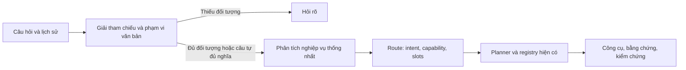

# Hướng xử lý router OCOP từ mã nguồn tham chiếu

Ngày: 2026-11-02. Đây là phần tiếp nối [chẩn đoán](router-diagnosis.md) và [khảo sát 11 repo](router-reference-study.md), tập trung vào quyết định triển khai. Không sửa runtime, gold, cấu hình hay PDF; không tuyên bố một thiết kế chưa chạy có accuracy cao hơn.

## Quyết định đề xuất

Giữ router/planner của OCOP, nhưng làm cho **một kết quả phân tích câu hỏi thống nhất** quyết định intent và các capability. Rules chỉ quyết định nhanh những trường hợp có cấu trúc rõ; embedding/LLM xử lý cách diễn đạt và xung đột nghiệp vụ. Mô hình không quyết định định danh nguồn hợp lệ hoặc đăng ký công cụ. Planner hiện có tiếp tục ánh xạ capability sang công cụ, áp dụng dependency và giới hạn tổng năm calls.

Tận dụng `Route`, `DialogueDecision`, `DocumentResolver`, `memory`, `scope_model`, `CAPABILITY_TO_TOOLS`, `build_plan` hiện có; không thêm một dịch vụ router, một framework agent, hoặc các router dự phòng chạy chồng nhau. Cần sửa điều kiện mâu thuẫn ngay tại nguồn thay vì thêm nhiều nhánh bù lỗi.

Nguồn về phần OCOP đã có: [contracts](../../ai_core/orchestration/ocop/contracts.py#L26), [workflow](../../ai_core/orchestration/ocop/workflow.py#L98), [registry](../../ai_core/orchestration/ocop/capabilities.py#L129), [planner](../../ai_core/orchestration/ocop/planner.py#L131).

## 1. Mẫu áp dụng từ từng dự án

| Nguồn code | Cơ chế thực sự có | Cách áp dụng cho OCOP | Giới hạn cần giữ rõ |
|---|---|---|---|
| Legal-RAG `backend/agent/query_router.py:16`, `backend/prompt.py:9` | Đưa query, lịch sử và văn bản hiện tại vào cùng lượt phân tích; trả standalone query, intent, filters | Tầng hiểu câu phải thấy tham chiếu hội thoại và scope đang ghim, không chỉ CURRENT | Không chép fallback mọi lỗi sang LEGAL_CHAT; không tin filters do model sinh |
| ViHERMES `src/vihermes/agents.py:34` | Model đề xuất regulatory/use_graph; định danh văn bản lấy riêng bằng regex; kiểm tra bool | Tách đề xuất ngữ nghĩa khỏi xác nhận định danh nguồn; OCOP dùng `DocumentResolver` thay regex tham chiếu | Schema của ViHERMES quá ít cho nghiệp vụ OCOP; regex không hỗ trợ mọi mã rút gọn OCOP |
| RAGFlow `internal/agent/component/categorize.go:185` | Category có mô tả/ví dụ và lịch sử; kết quả map sang downstream handle | Viết rõ ranh giới criteria/recognition, temporal/relation; map nhãn hợp lệ sang capability server | Một category không đủ đại diện cho câu nhiều nhu cầu; one-hot score không phải confidence |
| RAGFlow `internal/agentic_rag/tool_search_chunks.go:137` | Mỗi call có `intent` là nhu cầu thông tin riêng; được truyền vào context lọc bằng chứng | Với câu nhiều ý, giữ mục tiêu từng phần khi tìm và kiểm coverage; không chỉ dựa vào một nhãn tổng quát | `intent` ở đây là câu mô tả nhu cầu, không phải enum intent OCOP; không dùng relevance làm entailment |
| Graphiti | Chọn entity từ candidate do hệ thống tạo và xác nhận lại ID | Khi có tham chiếu mơ hồ, model chỉ chọn trong candidate từ hội thoại/catalog, không đoán văn bản | Xem nguồn và giới hạn trong [khảo sát bổ sung](router-additional-patterns.md); đây không phải router nghiệp vụ OCOP có thể chép nguyên |
| R2R `py/core/base/agent/agent.py:127`, `py/core/agent/base.py:168` | Dispatch tool theo registry, lưu kết quả từng vòng | Giữ registry và trace; proposal và plan thực thi phải đối chiếu được | Không đổi năm tool calls thành năm model rounds |

Các số dòng thuộc checkout pin trong báo cáo khảo sát. Không coi chúng là upstream mới nhất. Ba nguồn kiểm tra lại trực tiếp trong lượt này:

- Legal-RAG: `0b4ca6fe9a445c52e0612664b561221acaeace41`.
- ViHERMES: `9cdbdb91b61f4552f10fe9642530a1afe6497f2f`.
- RAGFlow: `12d9a38e24bf3fb8573b83bc41a2fe75dcd2c281`.

## 2. Thử cơ chế bằng code upstream thật

Đã import trực tiếp `vihermes.agents.Interpreter` từ checkout, chỉ thay cổng model bằng fake trả dữ liệu định sẵn; không cài hay khởi động toàn hệ thống upstream.

| Probe | Kết quả thực tế |
|---|---|
| Model trả `document_ids=["INVENTED"]`, query có `26/2026/QĐ-TTg` | Plan chỉ giữ `26/2026/QĐ-TTG` từ query; ID model bịa bị bỏ |
| Model trả `regulatory="true"` dạng string | `ValueError`, không chấp nhận string thay bool |
| Không có model, hỏi cách nấu bún bò Huế | `regulatory=True`, `use_graph=True` — fallback không đủ hẹp cho OCOP |
| Query chỉ ghi `797/QĐ-UBND` | Danh sách document ID rỗng — regex upstream cần năm trong mã |

Probe đầu chứng minh ranh giới model/identity của implementation hoạt động với input đã thử; không chứng minh model hiểu đúng intent. Hai probe cuối là lý do chỉ lấy nguyên tắc, không chép interpreter/regex/fallback. Nguồn: [Interpreter](https://github.com/ura-hcmut/ViHERMES/blob/9cdbdb91b61f4552f10fe9642530a1afe6497f2f/src/vihermes/agents.py#L34), [DOCUMENT_CODE](https://github.com/ura-hcmut/ViHERMES/blob/9cdbdb91b61f4552f10fe9642530a1afe6497f2f/src/vihermes/ingestion.py#L13).

## 3. Cấu trúc quyết định cụ thể cho OCOP

Đây là sơ đồ trách nhiệm trong một hệ thống, không phải các giai đoạn phát triển hay chế độ runtime mới.

### 3.1. Scope: giải đối tượng trước khi phục hồi miền

- “Văn bản đó còn áp dụng không?” khi không có văn bản nào trong query/history: `needs_clarification=True`, hỏi văn bản nào. Bigram giống corpus không được coi là đã xác định được đối tượng.
- Nếu query ghi số hiệu rõ hoặc history đã ghim một văn bản phù hợp, dùng `DocumentResolver` và memory hiện có để giữ phạm vi ấy. Không ghép một văn bản khác chỉ vì năm mới xuất hiện.
- Match `Huế` chỉ nhận diện địa phương. Để coi câu thuộc nghiệp vụ cần ý hỏi/domain signal hoặc tham chiếu hợp lệ từ history. Không cần bổ sung danh sách mọi món ăn để chặn “bún bò Huế”.
- Dùng các helper hiện có trong `memory.py` để xử lý trường hợp tham chiếu, mở rộng đúng chỗ cho tham chiếu đơn không giải được. Không dùng số từ làm đại diện duy nhất cho thiếu đối tượng.

Nguồn hiện trạng: [memory](../../ai_core/orchestration/ocop/memory.py#L148), [scope recovery](../../ai_core/orchestration/ocop/router.py#L846), [DocumentResolver](../../ai_core/orchestration/ocop/document_scope.py#L1). Bài học history/context từ Legal-RAG; candidate validation từ Graphiti. Các quy tắc phạm vi OCOP trong đoạn này là đề xuất thiết kế, không phải hành vi có sẵn của hai repo đó.

### 3.2. Nghiệp vụ: một quyết định, nhiều capability khi cần

Loại bỏ việc capability nhận document+page trong khi intent chỉ nhận document+article. Kết quả đọc locator phải được sử dụng chung cho intent và công cụ. Tương tự, một kết luận về quan hệ sửa đổi/thay thế phải được phản ánh nhất quán ở capability và intent.

Đối với câu nhiều ý, giữ một intent chính để trình bày và lưu phiên, nhưng không bỏ các capability thực sự cần chỉ vì chúng không thắng một cuộc đua điểm số. OCOP đã có `secondary_intents` và `capabilities`; cần làm rõ cách suy ra, không tạo bản sao của `Route` ở một module mới.

Ví dụ mong muốn:

| Câu hỏi | Quyết định cần có | Công cụ chính hoặc nhóm nhiệm vụ |
|---|---|---|
| Trang 2 của văn bản X ghi gì? | Exact lookup từ locator rõ | `lookup_legal_unit` |
| Điều kiện dùng lao động địa phương được tính mấy điểm? | Criteria, dù không chứa nguyên cụm “thang điểm” | `lookup_criterion`, thêm taxonomy khi cần xác định phiếu |
| Văn bản A sửa văn bản B ở đâu? | Quan hệ sửa đổi + đối chiếu nội dung | Search và graph, đúng hai văn bản đã resolve |
| Văn bản A thay văn bản nào, chuyển tiếp ra sao? | Relation và temporal cùng có mặt | Search/graph và temporal theo dữ liệu xác minh sẵn có |

Không cố chứng minh temporal hay multihop là nhãn duy nhất đúng cho mọi câu giao nhau. Cần định nghĩa nhiệm vụ chính, sau đó chấm cả capability/tool set được chấp nhận. Mọi verdict hiệu lực vẫn phải dựa vào reference rules phù hợp corpus, không dựa vào intent model.

### 3.3. Tầng hiểu ngôn ngữ: dùng model đúng điểm thiếu nghĩa

Rules tiếp tục xử lý locator rõ, privacy, policy, giới hạn và những mẫu chắc chắn. Với câu diễn đạt tự nhiên hoặc có xung đột nghiệp vụ:

1. Semantic tier đề xuất nhãn như hiện tại.
2. Nếu quyết định nghiệp vụ vẫn chưa phân biệt được, cho `scope_model` thấy query, history cần thiết, slot/candidate đã xác nhận và các cách hiểu đang xung đột; trả proposal có schema.
3. Server xác nhận proposal và dựng `Route` thống nhất. Model không cấp tên tool, `verified`, quyền, graph seed hay source ID tùy ý.

Cần bỏ bất đối xứng “có score luật yếu thì chỉ hỏi embedding, không hỏi model; không có score mới được hỏi model”. Không mở model để lật quyết định privacy hoặc giả định rằng mọi score cao đều sai; lỗi cấu trúc đã biết phải sửa trực tiếp.

Đề xuất model có thể gồm intent chính, intent phụ và nhu cầu hỏi rõ đối tượng; các slot đề xuất phải được đối chiếu với query/history và resolver. Nếu lưu span trong query để kiểm slot, span đó chỉ chỉ vị trí chữ người dùng, không được coi là bbox/evidence của PDF.

Không áp dụng ngay ngưỡng 0,50 từ thí nghiệm dev; ngưỡng và ví dụ cần tập calibration độc lập. Chưa có bằng chứng thay nearest-example bằng centroid sẽ giải quyết lỗi scope, thiếu antecedent hay capability/intent lệch nhau.

Nguồn để so cơ chế: [RAGFlow category prompt](https://github.com/infiniflow/ragflow/blob/12d9a38e24bf3fb8573b83bc41a2fe75dcd2c281/internal/agent/component/categorize.go#L185), [ViHERMES model/identity boundary](https://github.com/ura-hcmut/ViHERMES/blob/9cdbdb91b61f4552f10fe9642530a1afe6497f2f/src/vihermes/agents.py#L38), [fallback hiện tại OCOP](../../ai_core/orchestration/ocop/router.py#L939).

### 3.4. Câu nhiều phần: giữ mục tiêu từng phần đến bằng chứng

RAGFlow gắn một nhu cầu thông tin vào từng search call rồi truyền nhu cầu ấy cùng câu hỏi tổng thể đến bộ lọc. Đây là một cơ chế thực sự chạy, không chỉ prompt mẫu: schema yêu cầu `intent`, `invokableRun` gắn nó vào context. Nguồn: [schema/caller](https://github.com/infiniflow/ragflow/blob/12d9a38e24bf3fb8573b83bc41a2fe75dcd2c281/internal/agentic_rag/tool_search_chunks.go#L137), [judge templates](https://github.com/infiniflow/ragflow/blob/12d9a38e24bf3fb8573b83bc41a2fe75dcd2c281/internal/agentic_rag/decision_judge.go#L61).

OCOP đã có `aspects` và tìm kiếm theo phần; không cần thêm một bộ decomposition khác. Phần nên thử là giữ liên kết **phần câu hỏi → capability/công cụ → evidence**, để phát hiện phần chuyển tiếp chưa được trả lời dù đã tìm được văn bản thay thế. Không lấy một nhãn tổng quát làm bằng chứng rằng mọi phần đã được xử lý.

Nguồn OCOP: [chuẩn bị aspects](../../ai_core/orchestration/ocop/workflow.py#L223), [tìm theo phần](../../ai_core/orchestration/ocop/tools.py#L380). Chưa benchmark việc đưa per-call information need của RAGFlow vào OCOP; chưa nên bổ sung một model relevance judge chỉ dựa vào source upstream. Relevance của một mắt xích không đồng nghĩa đủ bằng chứng cho claim cuối.

## 4. Đánh giá phải đi cùng thiết kế

Giữ nguyên chỉ số intent/lane cũ để so sánh lịch sử, đồng thời bổ sung:

- `primary_lane` từ công cụ bắt buộc và `execution_lane` từ toàn kế hoạch; công bố hai trường riêng, không âm thầm đổi nghĩa `retrieval_path`.
- Gold required/acceptable/prohibited tools. Một số câu có nhiều kế hoạch đúng; một lane bằng nhau không chứng minh tool set đúng.
- Slot accuracy theo loại và cấp: document/version, product, ward/province; antecedent được giải đúng hay hỏi rõ đúng.
- Coverage từng nhu cầu, source/version correctness và answer grounding. Giữ deterministic checks cho score/star, page, bbox, evidence ID, SHA-256.
- Tổng tool calls, các tool optional thật sự đã chạy, latency/token; không coi số model rounds là số tool calls.

ViHERMES lưu prediction theo dòng, mẫu số riêng cho từng metric và phân tầng theo hop: [evaluation.py](https://github.com/ura-hcmut/ViHERMES/blob/9cdbdb91b61f4552f10fe9642530a1afe6497f2f/src/vihermes/evaluation.py#L32). OCOP cần bổ sung gold tool set độc lập; không tạo gold bằng chính output của router.

## 5. Thứ tự thay đổi được đề xuất

| Việc | File OCOP chính | Bằng chứng nghiệm thu |
|---|---|---|
| Tách số đo primary và execution; giữ điểm cũ | `tools/evaluate_router.py`, `retrieval_strategy.py` | Recognition có graph phụ không bị đánh đồng với sai công cụ chính; vẫn phát hiện primary thiếu lookup |
| Thống nhất exact locator và quan hệ nghiệp vụ | `router.py` | Document+page tạo đúng intent và tool; relation không rơi về overview chỉ vì thiếu score |
| Giải tham chiếu thiếu và domain signal | `memory.py`, `router.py` | Câu hỏi văn bản mơ hồ hỏi rõ; địa phương không tự biến câu ngoài miền thành OCOP |
| Làm rõ schema/ranh giới nhãn và điểm gọi model | `scope_model.py`, `router.py`, `workflow.py` | Các cách diễn đạt độc lập nhận cùng nhiệm vụ; proposal không thay pinned version hoặc thêm ID không có |
| Đo câu nhiều phần theo capability/evidence | `aspects.py`, `tools.py`, evaluator | Cả quan hệ thay thế và chuyển tiếp đều có coverage riêng hoặc abstention đúng |

Mỗi thay đổi cần case tái hiện ở seam thực sự, test bảo toàn policy/version/budget, rồi chạy dev. Chốt thiết kế trước khi chạy sealed tổng hợp; không dùng lỗi từng câu sealed để vá. Nếu module đổi thuộc fingerprint thì kiểm tra nhu cầu rebuild bằng CLI status trước khi chạy đánh giá end-to-end. Nghiên cứu này chưa thay fingerprint nào.

## 6. Những hướng không được nguồn code hiện có hỗ trợ

- Thay toàn bộ bằng LightRAG/GraphRAG không tự tạo một router nghiệp vụ OCOP: mode của chúng phần lớn do caller chọn.
- Hạ threshold hoặc thêm hàng loạt keyword không sửa bất nhất giữa capability và intent, hoặc thiếu đối tượng hội thoại.
- Chép fallback “không hiểu thì cứ truy xuất” từ Legal-RAG/ViHERMES làm phạm vi OCOP quá rộng.
- Chép `max_iterations` hoặc prompt “chỉ gọi một lần” không đảm bảo giới hạn tổng tool calls; xem khảo sát bổ sung về navinsreyas.
- Không có cơ sở hứa accuracy 90–95% từ các repo này. Kết quả đã đo của OCOP với LLM là 80% intent trên 80 câu; những thay đổi đề xuất ở trên vẫn cần thực nghiệm.

Kết quả của lượt này là hướng thiết kế và nguồn code có thể đối chiếu, cùng probe nhỏ trên implementation upstream. Không có thay đổi chạy thật hoặc số accuracy mới cho thiết kế đề xuất.
